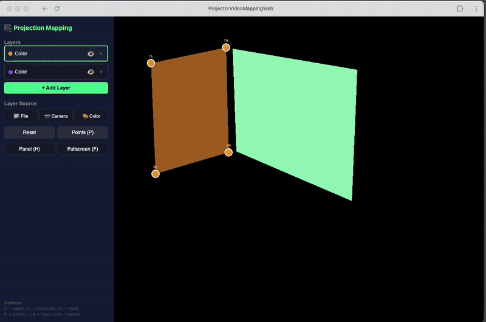

# 🎥 Projection Mapping Web

**[Open App](https://adriangoris.github.io/web-projection-mapper/app.html)**

A powerful, browser-based projection mapping tool built with WebGL. Create stunning visual projections by mapping videos, images, or camera feeds onto any surface with precise 4-corner perspective correction.

## Features

- **Multi-Layer Support** - Work with multiple layers simultaneously for complex compositions
- **Multiple Input Sources**
  - 📁 File upload (video/image)
  - 📷 Live camera feed
  - 🎨 Solid colors
- **Real-Time Warping** - Drag corner points to map your content onto any surface
- **Layer Management** - Show/hide, reorder, and delete layers
- **Timeline Playback** - Sequence clips on per-layer tracks with a time ruler, playhead scrubbing, looping, and zoom
- **Keyboard Shortcuts** - Fast workflow with hotkeys
- **Fullscreen Mode** - Perfect for live presentations
- **No Installation** - Runs entirely in your browser

## Usage

1. [Open App](https://adriangoris.github.io/web-projection-mapper/app.html) in your browser
2. Click **+ Add Layer** to create a new projection layer
3. Choose your content source:
   - **📁 File** - Upload a video or image
   - **📷 Camera** - Use your webcam
   - **🎨 Color** - Generate a solid color
4. Drag the corner points to map the content onto your target surface
5. Add more layers as needed for complex projections
6. Arrange clips in the **Timeline** at the bottom and press `Space` to play

## Timeline

The Timeline panel runs along the bottom of the screen:

- **Time Ruler** - Click or drag to scrub. `Ctrl`/`⌘` + scroll (or pinch) to zoom
- **Playhead** - The cyan marker and line showing the current time
- **Tracks** - One row per layer; click a track header to select that layer
- **Clips** - Each source you load becomes a clip. Drag a clip to move it (it snaps to the playhead and other clip edges), drag it onto another track to change its layer, and drag its edges to trim it
- Source buttons replace the **selected clip**. If no clip is selected, they add a new clip at the playhead (click an empty spot on a track to deselect)

## Keyboard Shortcuts

| Key | Action |
|-----|--------|
| `H` | Toggle control panel |
| `F` | Toggle fullscreen |
| `P` | Toggle corner points visibility |
| `R` | Reset active layer corners |
| `1-9` | Switch between layers |
| `T` | Toggle timeline |
| `Space` | Play / pause |
| `←` / `→` | Step one frame (hold `Shift` for 1s) |
| `Home` / `End` | Jump to start / end |
| `Delete` | Delete selected clip (or active layer if no clip selected) |

## Controls

- **Reset** - Reset corner positions to default
- **Points (P)** - Show/hide corner control points
- **Panel (H)** - Show/hide control panel
- **Fullscreen (F)** - Enter/exit fullscreen mode

## Technical Details

- Built with vanilla JavaScript and WebGL
- Uses perspective correction shader for accurate mapping
- Supports real-time video playback
- Hardware-accelerated rendering
- No external dependencies

## Browser Compatibility

Works in all modern browsers that support:
- WebGL
- MediaDevices API (for camera input)
- ES6+ JavaScript

## License

MIT License - Feel free to use for personal or commercial projects

